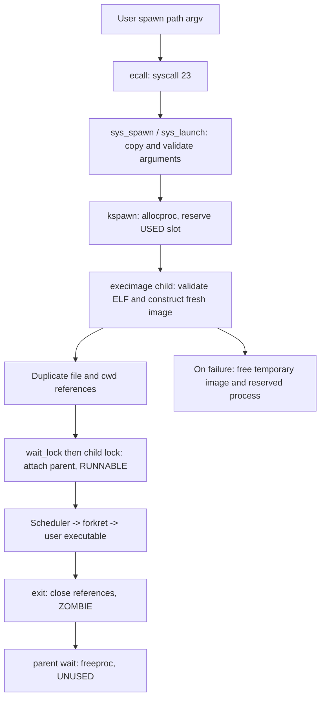

# Rethinking Process Creation: An Alternative to Fork-Based Process Creation

## Abstract

This project adds `spawn(path, argv)` to xv6 RISC-V as a kernel operation that constructs a child directly from an ELF executable. The child receives fresh user memory and initial registers rather than a copy of its parent's address space. Existing allocation, scheduling, exit, and wait mechanisms remain in use. A shared executable loader serves both exec and spawn, and the child becomes runnable only after loading succeeds. Tests exercise valid construction, argument failures, malformed executables, inheritance, process-table exhaustion, and physical-memory pressure. A reproducible benchmark compares sequential fork+exec and spawn launches at several parent heap sizes. Results and raw logs accompany the implementation; conclusions are limited to this eager-copy xv6 baseline under QEMU.

## Problem statement and motivation

A program launcher commonly creates a process only to replace its memory immediately. In this checkout, `kfork()` invokes `uvmcopy()`, which allocates and copies each mapped page of the parent. The child then calls `kexec()`, which builds a new image and frees the copied one. For a large parent launching a small executable, this intermediate image performs work unrelated to the desired program.

Fork remains useful when the child should continue the parent's computation. The question here is narrower: can xv6 create a child from an executable specification while preserving its ordinary lifecycle, without deriving user memory from the parent?

## Research gap, scope, and objectives

Spawn-style interfaces are established operating-system techniques. The scope is an inspectable implementation and controlled evaluation within this particular teaching kernel. The contribution is the executable-first construction path, explicit inheritance contract, transactional image loading, failure cleanup, and evidence comparing it against the same checkout's fork+exec path. It is an undergraduate systems implementation and experiment, not a claim that spawn is a new concept.

The objectives are to preserve existing interfaces, avoid `kfork()` and `uvmcopy()` in spawn, start the requested image with valid arguments, integrate normal wait/exit semantics, reject incomplete construction, and measure behavior without hiding unfavorable or inconclusive observations.

## Existing fork-based process creation

`allocproc()` reserves a process slot in `USED` state, allocates a trapframe and an initially empty user page table, and initializes a kernel context that starts at `forkret()`. `kfork()` copies mapped user pages with `uvmcopy()`, copies the parent's trapframe, changes the child's return register to zero, and duplicates file and cwd references. It establishes the parent relationship and makes the child runnable.

`kexec()` replaces the calling process's user image. It does not create a PID. It builds a temporary page table, loads ELF segments, creates a guarded stack, copies arguments, installs entry and stack registers, then frees the old image. A failed exec preserves the old image.

The baseline supports lazy heap growth, but fork copies each page that is actually mapped; it does not implement copy-on-write. The benchmark deliberately uses eager heap allocation to control this distinction.

## Proposed architecture



The syscall copies arguments from the *calling parent*, whereas the loader builds the image for an explicit target `struct proc *`. Filesystem path resolution also runs in the caller's context, so a relative executable path uses the parent's cwd. No temporary switch of the current process is required.

## Interface and resource contract

```c
int spawn(const char *path, char **argv);
```

A positive PID means an executable image was successfully prepared and the child was published to the scheduler. `-1` means construction failed and no runnable child was published. A reserved PID may be consumed by a failed attempt; PID sequences need not be contiguous. Success does not imply the program will eventually exit successfully.

`path` must fit xv6's `MAXPATH` buffer including its terminating zero. `argv` must be a readable, zero-terminated array. At most 31 strings are accepted: `MAXARG` is 32 and the final slot is the terminating pointer. Each argument is copied through a kernel page-sized buffer; strings and their pointer array must also fit the one-page user stack after alignment. An array whose first entry is zero is accepted. A null array pointer is not a special shorthand for an empty array.

| Resource | Policy |
| --- | --- |
| User text, data, BSS, heap, stack | New image; no parent pages copied or shared |
| General user registers | Zeroed, then entry/SP/argc/argv configured |
| PID and kernel scheduling context | Newly allocated through allocproc |
| File descriptor numbers | Inherited in the same slots |
| Open file descriptions | Reference-counted sharing; offsets and pipe endpoints are shared |
| Descriptor table | Separate table; closing a child descriptor does not close the parent's slot |
| Current working directory | Shared inode reference through idup |
| Process parent | Calling process; normal orphan reparenting remains available |
| Environment, file actions, credentials | No new facilities beyond xv6's existing model |

Inheritance follows fork's existing resource semantics. No close-on-exec facility is introduced. In particular, inherited pipe writers can keep a pipe open; callers must account for that contract.

## Implementation details and memory management

`kernel/proc.c:kspawn()` replaces the previous placeholder. It calls `allocproc()`, drops the returned process spinlock, clears the new trapframe, and invokes `execimage(np, path, argv)`. The reserved child cannot be selected by the scheduler while its state is `USED`. ELF reading can sleep, so holding the child's spinlock during loading would be incorrect.

`kernel/exec.c:execimage()` contains the refactored loader. `kexec()` delegates to it with `myproc()`; spawn passes its new child. The initial empty page table from allocproc is replaced and freed on successful loading. This briefly creates an extra empty page-table hierarchy; it keeps allocation ownership simple and preserves the established exec commit mechanism.

The loader validates ELF magic, 64-bit little-endian format, executable type, RISC-V machine, version, and program-header layout and file bounds. Loadable segments must have file size no larger than memory size, no virtual-address wraparound, page-aligned starts, ascending nonoverlapping virtual ranges, and room below the special trapframe mapping for the stack and guard. File offsets and file sizes must stay within the inode. The entry must map a user-executable page. These checks strengthen the shared loader; this is a static xv6 ELF loader, not a general dynamic linker.

`uvmalloc()` provides zeroed pages, so BSS and unused stack memory are initialized without parent contents. `loadseg()` reads file-backed bytes into those pages. As in the original xv6 loader, permissions follow ELF flags with readable user mappings, and virtual gaps may be allocated eagerly. No W^X policy is added.

The stack follows the image at a page boundary. The guard page has its user permission cleared using `uvmclear()`. Strings and the argument-pointer array are copied with `copyout()` into the private page table. SP is aligned to 16 bytes. `a0` receives argc, `a1` points to argv, and `epc` receives the entry address. Setting `a0` explicitly is essential for spawn: the child's registers are not supplied by the parent's syscall return path. `kexec()` still returns argc to the caller's syscall machinery, preserving exec's behavior.

No new scheduler or page-table format is required. `allocproc()`'s context leads the scheduler through `forkret()` and the trampoline into the new user entry point.

## Locking and process lifecycle

```text
UNUSED --allocproc--> USED --complete image + inherited refs--> RUNNABLE
                         \--failure/freeproc---------------> UNUSED
RUNNABLE --scheduler--> RUNNING --exit--> ZOMBIE --wait--> UNUSED
```

The calling process owns construction of the `USED` child. The loader does not modify its state. Resource inheritance occurs only after the last operation that can fail, so the failure branch needs no fileclose/iput rollback for inherited references. Existing `filedup()` and `idup()` increment references and do not allocate new file/inode table entries.

Publication takes `wait_lock` before the child's lock, following wait/exit ordering. The parent pointer is established before `RUNNABLE` is written. The parent relationship is not exposed during loading. On one CPU the child may run immediately after publication; on multiple CPUs it may run before spawn returns. Code must rely on the returned PID and wait, not output order.

Exit closes file references and releases cwd through the existing path. Wait reaps the zombie, clears its parent, and invokes `freeproc()`. Spawn needs no special zombie representation.

## Error handling and ownership

| Failure point | Cleanup |
| --- | --- |
| User path/argv validation or argument-buffer allocation | sys_launch frees all allocated argument pages |
| No process slot, trapframe, or initial page table | allocproc's existing rollback |
| namei/header/segment validation or read failure | Unlock/release inode, end filesystem operation, free temporary image |
| Image or stack allocation/copy failure | Free temporary page table and its mapped user pages |
| execimage failure during spawn | Lock child and free its reserved process resources |
| Program failure after successful publication | Normal exit and parent wait |

The loader commits only after all fallible image construction is complete. Failed exec leaves the caller's previous user image usable. Failed spawn frees the child's empty original page table as well as any temporary loader allocations. Kernel argument pages are released whether the kernel launch succeeds or fails.

## Testing and experimental observations

See [VERIFICATION.md](VERIFICATION.md) for the fresh pre-push audit and [TESTING.md](TESTING.md) for executed checks and their precise limits. [BENCHMARK.md](BENCHMARK.md) defines the experiment; [BENCHMARK_RESULTS.md](BENCHMARK_RESULTS.md) contains values extracted from the recorded run. The raw console transcript is retained rather than substituting example results.

The repository initially contained only an incomplete kspawn allocation/free stub. The first compiled implementation booted and passed the initial spawn tests. Follow-up tests added memory exhaustion and progressively restricted allocation budgets; these exercised failure and recovery without an observed panic. The environment's command sandbox failed before launching shell commands, requiring approved execution outside that sandbox. The final SMP test additionally completed four concurrent spawners and recovered 32,471 pages both before and after the suite. Full three-CPU usertests, including its slow tests, passed. No debugging incident or kernel failure is implied beyond what is recorded in the logs.

## Comparison and discussion

| Mechanism | Child's first user computation | Parent-memory derivation | Principal role |
| --- | --- | --- | --- |
| xv6 fork | Returns from fork in parent program | Eager copy of mapped pages | Continue a computation in a new process |
| xv6 fork+exec | Fork continuation, then executable | Eager intermediate copy, then replacement | Launch another executable |
| This spawn | Entry of requested executable | No copied parent user pages | Direct executable construction |
| POSIX-style spawn | Requested executable with attributes/actions | Implementation-dependent | Portable process-launch interface |

Spawn sacrifices arbitrary child-side code between creation and exec. Adding descriptor actions is a possible extension, but unconstrained callbacks would recreate much of fork's complexity.

The checked glibc Linux implementation uses clone with shared-memory/vfork-style flags and a dedicated child stack. That is a different strategy from this independent page-table construction; this project does not evaluate it. [glibc source](https://raw.githubusercontent.com/bminor/glibc/master/sysdeps/unix/sysv/linux/spawni.c).

The previously considered μFork direction preserves fork semantics in a single-address-space design using CHERI for relocation and isolation. This project retains xv6's separate page tables and launches a new executable instead. Its implementation and results cannot establish μFork's performance or reproduce that paper's contribution. [μFork abstract](https://arxiv.org/abs/2509.09439).

Fork, Explore, Commit studies branch contexts for isolated exploration with filesystem/process lifecycle and commit/abort semantics. The abstract distinguishes implemented BranchFS from a proposed Linux branch syscall. This xv6 project has neither filesystem rollback nor branch commits; it addresses executable creation. [Fork, Explore, Commit abstract](https://arxiv.org/abs/2602.08199).

## Limitations and future scope

The API is deliberately smaller than POSIX spawn: no environment vector, PATH search, descriptor action list, sessions, or signal attributes. All errors collapse to `-1`. A malformed but structurally accepted executable can still fault when executed. Permission checking follows xv6's basic model. Allocation-pressure tests and regression runs provide evidence, not exhaustive proofs of race freedom or absence of leaks.

The timing experiment includes executable loading, scheduling, execution, exit, and wait; it does not isolate syscall latency, peak allocation count, or energy. It uses a small executable under nested virtualization/emulation, not native RISC-V hardware. Fork results should not be generalized to copy-on-write kernels.

Useful extensions include a descriptor-action API, structured errno reporting, per-launch allocation counters, high-resolution kernel timing, random allocation-failure injection, broader concurrent-spawner stress, copy-on-write fork comparisons, and larger executable workloads. Each should retain a clear ownership model and failure boundary.

## Conclusion

A child can be constructed directly from an executable within xv6's existing process infrastructure. The implementation removes the parent's intermediate copied user image from the launch path while preserving ordinary scheduling and wait/exit cleanup. Its practical benefit must be assessed using the recorded benchmark and its stated measurement limits.

## References and verification status

1. Local xv6 source, base commit `e93dabeb98431235c6e1a101cb96c73c923fdbc4`: primary authority for this implementation. Compare with the working tree, not a different xv6 release.
2. Cox, Kaashoek, Morris, *xv6: a simple, Unix-like teaching operating system*, revision dated September 2, 2025. [MIT book](https://pdos.csail.mit.edu/6.1810/2025/xv6/book-riscv-rev5.pdf). Contents checked; function names may differ from this checkout.
3. GNU C Library Linux `spawni.c`, source inspected through the linked mirror. [Source](https://raw.githubusercontent.com/bminor/glibc/master/sysdeps/unix/sysv/linux/spawni.c). A moving branch: pin a release/commit before formal citation.
4. John Alistair Kressel, Hugo Lefeuvre, Pierre Olivier, *μFork: Supporting POSIX fork Within a Single-Address-Space OS*, arXiv:2509.09439v2. Abstract and author metadata checked; full-paper claims and final proceedings details require verification before submission. [Record](https://arxiv.org/abs/2509.09439v2).
5. Cong Wang, Yusheng Zheng, *Fork, Explore, Commit: OS Primitives for Agentic Exploration*, arXiv:2602.08199v2. Abstract and metadata checked; full-paper findings were not independently reproduced. [Record](https://arxiv.org/abs/2602.08199v2).
6. The Open Group, `posix_spawn` specification. [Specification](https://pubs.opengroup.org/onlinepubs/9799919799/functions/posix_spawn.html). Automated retrieval returned HTTP 403; verify the exact edition and normative wording manually. This project's interface is not claimed to be POSIX-conforming.
